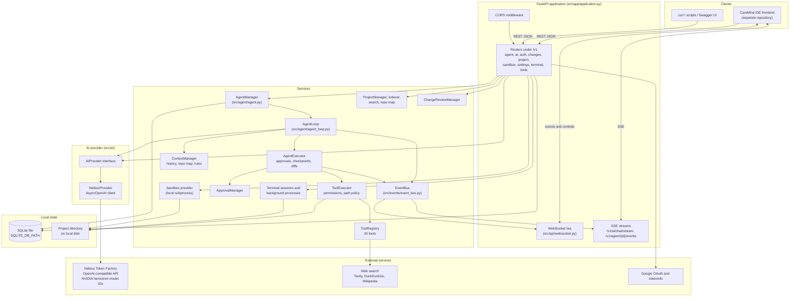
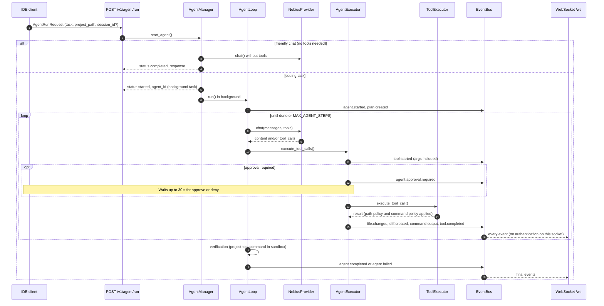

# CoreMind Backend

[](https://www.python.org/)
[](https://fastapi.tiangolo.com/)
[](LICENSE)

FastAPI backend for the CoreMind AI development environment. It provides AI chat, an agent loop that plans and calls workspace tools, project search, change review, persistent terminal sessions, and Google sign-in. Model inference goes through the OpenAI-compatible API of **Nebius Token Factory**, using NVIDIA Nemotron model IDs.

> [!WARNING]
> **Not production-ready.** Most routes now require a Bearer token, and direct command execution is off by default. Several issues remain open (see [Known issues](#known-issues)). Run this backend only on a trusted machine, bound to `127.0.0.1`, and do not expose it to a network.

**Contents:** [Features](#backend-responsibilities-and-implemented-features) · [Technology stack](#technology-stack) · [Architecture](#system-architecture) · [Request lifecycle](#request-lifecycle-and-frontend-communication) · [API reference](#api-reference) · [Nebius integration](#nebius-token-factory-integration) · [NVIDIA models](#nvidia-nemotron-model-integration) · [Installation](#installation) · [Configuration](#configuration-environment-variables) · [Running](#running-the-backend) · [Database](#database-and-persistence) · [Testing](#testing-linting-and-build) · [Security](#security-considerations) · [Troubleshooting](#troubleshooting) · [Deployment](#deployment) · [Frontend](#frontend) · [Contributing](#contributing) · [Known issues](#known-issues) · [License](#license)

---

## Overview

The backend exposes:

- **AI endpoints** for one-shot chat, streaming chat (Server-Sent Events), planning, and code generation.
- **An agent loop** that analyzes a task, builds a task graph, calls up to 30 registered tools (read, write, edit, search, git, terminal, tests, build), runs post-edit validation and project verification, and reports progress as events.
- **Workspace services**: project detection and indexing, file tree, hybrid search, repo map, and per-file change review (accept or reject).
- **Terminal services**: stateful shell sessions and managed background processes.
- **A WebSocket event stream** (`/ws`) and per-task SSE streams for IDE clients.
- **Google sign-in** that issues the backend's own JWT access and refresh tokens.

The backend is a single Python process with in-memory singletons for agents, approvals, events, and terminal sessions. Durable data is stored in a local SQLite file.

---

## Backend responsibilities and implemented features

Status labels: **Verified** means exercised against the running backend or a direct test during the 2026-10-16 audit. **Implemented** means code and unit tests exist, but the feature was not exercised end to end. **Known issue** means a defect is listed in [Known issues](#known-issues).

| Area | What it does | Status |
|---|---|---|
| Health and metadata | `GET /`, `GET /health`, OpenAPI docs at `/docs` | Verified |
| Model connectivity | `POST /v1/ai/test` makes one minimal Nebius request | Verified (one successful call, see [Nebius integration](#nebius-token-factory-integration)) |
| Model catalogue | `GET /v1/ai/models` lists models from Nebius | Verified (28 models returned, configured model present) |
| One-shot and streaming chat | `POST /v1/ai/chat/friendly`, `POST /v1/ai/chat/stream` | Implemented; streaming not live-verified |
| Agent loop | `POST /v1/agent/run` and `POST /v1/ai/chat` run the tool-calling loop | Implemented; not run end to end in this audit |
| Tools | 30 registered tools; `GET /v1/tools/list` shows names, permissions, timeouts | Verified for read, search, and terminal paths; others implemented |
| Project workspace | Open, tree, hybrid search, repo map | Verified (search); [Known issue SEC-01](#known-issues) |
| Change review | Per-file accept and reject of agent edits | Implemented; [Known issues REL-01, REL-02](#known-issues) |
| Terminal sessions | Stateful shell sessions and background processes | Verified; [Known issue SEC-02](#known-issues) |
| Event stream | `/ws` WebSocket and `/v1/agent/{id}/events` SSE | Verified (WebSocket delivers command output); [Known issue SEC-03](#known-issues) |
| Authentication | Google sign-in, JWT access and refresh tokens, `/v1/auth/me`, `/v1/auth/profile` | Implemented; [Known issues SEC-07, SEC-08](#known-issues) |
| Durable memory | `memory_save`, `memory_recall`, `memory_forget` tools backed by SQLite | Implemented (unit tests only) |
| Web search | Tavily when a key is set, DuckDuckGo and Wikipedia otherwise | Implemented; not verified live in this audit |
| Sandbox | `/v1/sandbox/*` and `sandbox_execute` run commands as local subprocesses | Implemented; **not isolated** (see [Security considerations](#security-considerations)) |
| Audit log | `GET /v1/agent/audit_logs` | Incomplete: nothing writes to the log, so it always returns `[]` ([REL-06](#known-issues)) |
| Nebius-hosted sandbox | `SANDBOX_TYPE=nebius` | Not implemented; the value falls back to the local sandbox ([REL-09](#known-issues)) |

---

## Technology stack

Versions below are the constraints in `pyproject.toml` and `requirements.txt`. There is no lockfile, so a fresh install resolves newer versions. A clean install on 2026-10-16 resolved FastAPI 0.143.2, openai 3.31.0, pydantic 2.14.1, and uvicorn 0.54.0.

| Layer | Technology | Where it is used |
|---|---|---|
| Language | Python 3.11+ (Dockerfile uses 3.11; the audit ran 3.12.9) | `pyproject.toml` `requires-python` |
| Web framework | FastAPI `>=0.115`, Starlette, uvicorn `[standard]` `>=0.32` | `src/app/`, `src/api/` |
| Real-time | `websockets >=14`, Server-Sent Events via `StreamingResponse` | `src/api/websocket.py`, `src/api/routes/ai.py`, `src/api/routes/agent.py` |
| Validation and config | pydantic `>=2.10`, pydantic-settings `>=2.7`, python-dotenv | `src/config.py`, route models |
| Model client | `openai` Python SDK `>=1.58` (`AsyncOpenAI`) pointed at Nebius | `src/ai/nebius/` |
| HTTP client | httpx `>=0.28` | Web search, Google OAuth |
| Auth tokens | PyJWT `>=2.8` (HS256). `bcrypt` is declared but not imported | `src/auth/security.py` |
| Persistence | SQLite via the standard library `sqlite3` | `src/auth/storage.py`, `src/agent/storage.py`, `src/memory/store.py` |
| Testing and quality | pytest, pytest-asyncio (`asyncio_mode = auto`), ruff, mypy (strict) | `pyproject.toml`, `tests/` |
| Container | `python:3.11-slim` | `Dockerfile` |

---

## System architecture



### Main modules

| Module | Responsibility |
|---|---|
| `src/app/` | Application factory, CORS, error handlers, `/health`, route registration. `bootstrap.py` loads `.env` and exposes `app` for uvicorn. |
| `src/api/routes/` | One router per area: `agent`, `ai`, `auth`, `changes`, `project`, `sandbox`, `settings`, `terminal`, `tools`. |
| `src/api/websocket.py` | `/ws` connections. Forwards every bus event and accepts approval, question, and stop messages. |
| `src/agent/` | `AgentManager` (lifecycle), `AgentLoop` (plan, act, observe, verify), `AgentExecutor` (approvals, checkpoints, diffs), planner, verifier, task graph, state machine, SQLite task storage. |
| `src/ai/` | `AIProvider` abstraction, `NebiusProvider` (OpenAI SDK against Nebius), streaming adapter, error mapping, usage tracker, text tool-call parser, prompts. |
| `src/tools/` | `ToolRegistry` (30 definitions), `ToolExecutor` (permission check, path policy, timeout), and tool implementations in `definitions/`. |
| `src/security/` | Path policy, command policy (denylist and classifier), permission manager, approval manager, audit logger (not yet wired). |
| `src/project/` | Project detection, file scanning and indexing, hybrid search (exact, symbol, term overlap), repo map. |
| `src/terminal/` | Terminal sessions, background processes, and the local web preview server. |
| `src/changes/` | Unified diffs and change sets for accept and reject. |
| `src/context/` | Context assembly, rules loading (`.coremindrules`, `AGENTS.md`, `.cursorrules`), compaction. |
| `src/auth/` | JWT issuing and verification, Google OAuth exchange, user storage. |
| `src/memory/` | Durable per-project memory items in SQLite. |
| `src/events/` | `CoreMindEvent` model and the in-process `EventBus`. |

---

## Request lifecycle and frontend communication

The IDE uses three channels:

1. **REST** (JSON request and response) for commands, queries, and configuration.
2. **Server-Sent Events** (`text/event-stream`) for streaming tokens from `/v1/ai/chat/stream`, and for per-task events from `/v1/agent/{task_id}/events`.
3. **WebSocket** (`/ws`) for the global event stream. The client also sends approval, question-answer, and stop messages over this socket.

An agent run looks like this:



Two details matter for clients:

- Events are published to **every** subscriber of the bus. Event payloads can contain file contents, tool arguments, and command output.
- `GET /v1/agent/{task_id}/history` returns the stored conversation. Poll it after a restart or when an SSE stream is not open.

---

## API reference

Base URL: `http://127.0.0.1:43110` (default port from `COREMIND_BACKEND_PORT`).

Canonical routes use the `/v1` prefix. The same handlers are also mounted at `/agent`, `/api/agent`, and `/ai`, and `/ws` is also mounted at `/v1/ws`. Those aliases are hidden from the OpenAPI schema.

### Conventions

- Request and response bodies are JSON unless noted. SSE responses use `text/event-stream`.
- **Authentication:** Every route except `/`, `/health`, `/auth`, the OpenAPI docs, and the sign-in endpoints under `/v1/auth` (`/google`, `/google/url`, `/google/callback`, `/session`, `/refresh`) requires `Authorization: Bearer <access_token>`. Tokens come from Google sign-in. A missing or invalid token returns HTTP 401. The WebSocket takes its token as a subprotocol (see [WebSocket](#websocket-ws)). `POST /v1/auth/logout` accepts an optional token.
- **Errors** come in three shapes today:

  | Shape | Produced by | Example |
  |---|---|---|
  | `{"error": {"code": "...", "message": "...", "details": {...}}}` | Domain errors (auth, tools, AI, sandbox) | `{"error":{"code":"AUTH_UNAUTHORIZED","message":"Missing Authorization Bearer token header."}}` |
  | `{"detail": "..."}` | Explicit `HTTPException` in routes | `{"detail":"Agent not found"}` (404) |
  | `{"detail": [ ... ]}` | Request validation (422) | `{"detail":[{"type":"missing","loc":["body","project_path"],...}]}` |

  Unhandled exceptions return HTTP 500 with `{"error": {"code": "INTERNAL_ERROR", "message": "Internal server error"}}`.

- Domain error codes are defined in `src/utils/errors.py`: `AI_AUTH_FAILURE`, `AI_RATE_LIMIT`, `AI_TIMEOUT`, `AI_MODEL_UNAVAILABLE`, `AI_BUDGET_EXHAUSTED`, `AI_UNKNOWN`, `TOOL_FILE_NOT_FOUND`, `TOOL_PERMISSION_DENIED`, `TOOL_INVALID_PATH`, `TOOL_INVALID_ARGS`, `TOOL_NOT_FOUND`, `TOOL_TIMEOUT`, `TOOL_EXECUTION_FAILED`, `SANDBOX_*`, `AGENT_*`, `AUTH_*`, `CONFIG_INVALID`, `BACKEND_UNAVAILABLE`, `INTERNAL_ERROR`.

### Health and metadata

| Method | Path | Auth | Response |
|---|---|---|---|
| GET | `/` | None | `{service, version, status, docs, health, auth, auth_api}` |
| GET | `/health` | None | `{"status":"ok","service":"coremind-backend","version":"1.0.0"}` |
| GET | `/auth` | None | Static HTML sign-in portal |
| GET | `/docs`, `/redoc`, `/openapi.json` | None | FastAPI documentation |

### Authentication (`/v1/auth`)

| Method | Path | Auth | Request | Response and notes |
|---|---|---|---|---|
| POST | `/v1/auth/google` | None | `{"id_token"?: string, "code"?: string, "redirect_uri"?: string}` | `TokenResponse`. Accepts a Google ID token or an authorization code. See [SEC-08](#known-issues). |
| GET | `/v1/auth/google/url` | None | Query: `state?`, `redirect_uri?` | `{"auth_url", "client_id", "state"}`. Registers the state; the callback accepts only states issued here, once. Uses a placeholder client ID when `GOOGLE_CLIENT_ID` is empty. |
| GET | `/v1/auth/google/callback` | None | Query: `code?`, `error?`, `state?` | HTML page. Rejects states this backend did not issue (HTTP 400). Writes the token payload to `localStorage` for the `/auth` portal and posts `{type: 'COREMIND_AUTH_SUCCESS'}` (no token) to `window.opener`. See [SEC-07](#known-issues). |
| GET | `/v1/auth/session` | None | Query: `state` (required, 400 without it) | `TokenResponse`, returned once per sign-in. HTTP 404 `{"status":"pending"}` until then. Desktop clients poll with the state they started with. |
| GET | `/v1/auth/me` | **Bearer** | None | `UserResponse` |
| PATCH | `/v1/auth/profile` | **Bearer** | `{"name"?: string, "avatar_url"?: string}` | `UserResponse` |
| POST | `/v1/auth/refresh` | None (token in body) | `{"refresh_token": string}` | New `TokenResponse`. Refresh tokens are not rotated. |
| POST | `/v1/auth/logout` | Optional Bearer | None | `{"status":"ok"}`. Nothing is revoked on the server. |

`TokenResponse` contains `access_token`, `refresh_token`, `token_type` (returned as `"Bearer"`), `expires_in` (seconds; default 7 days), and `user`.

### Agent (`/v1/agent`)

| Method | Path | Auth | Request | Response and notes |
|---|---|---|---|---|
| POST | `/v1/agent/run` | None | `AgentRunRequest`: `task` or `prompt` (one required), `project_path` or `project_id` or `workspace_path` (one required), `session_id?`, `context_files?`, `model?` | `{"agent_id","task_id","session_id","status","response"?}`. `status` is `started` for coding tasks and `completed` for friendly chat. Returns 422 if `task` or `project_path` is missing. |
| POST | `/v1/agent/task` | None | Same as `/run` | Same as `/run` |
| POST | `/v1/agent/stop` | None | `{"agent_id"?: string, "task_id"?: string}` | `{"status":"stopped","agent_id","task_id"}`. 404 if unknown. |
| POST | `/v1/agent/cancel` | None | Same as `/stop` | Same as `/stop` |
| POST | `/v1/agent/{agent_id}/stop` · `/cancel` | None | None | Same as `/stop` |
| POST | `/v1/agent/task/{task_id}/stop` · `/cancel` | None | None | Same as `/stop` |
| POST | `/v1/agent/stop_all` | None | None | `{"status":"emergency_stop_executed","agents_stopped": n}` |
| GET | `/v1/agent/status?agent_id=` | None | Query | Agent status object. 404 if unknown. |
| GET | `/v1/agent/tasks` | None | None | Up to 100 tasks, each with its full `messages` array. No pagination. |
| GET | `/v1/agent/{task_id}` · `/task/{task_id}` | None | None | Agent status object. 404 if unknown. |
| GET | `/v1/agent/{task_id}/history` | None | None | `{"task_id","session_id","status","messages","files_changed","steps_completed","tool_calls_count","task_graph"}` |
| GET | `/v1/agent/{task_id}/events` · `/stream` | None | None | SSE. Each frame is `event: <type>` and `data: <CoreMindEvent JSON>`. A `: keepalive` comment is sent after 2 s of silence. |
| DELETE | `/v1/agent/{task_id}` · `/task/{task_id}` | None | None | `{"status":"deleted","task_id"}`. Deletes the stored row, even while the task is running. |
| GET | `/v1/agent/questions?agent_id=` | None | Query | Pending `ask_user` questions |
| POST | `/v1/agent/question` | None | `{"question_id": string, "answer": string}` | `{"status":"answered"}`, or 404 |
| POST | `/v1/agent/approve` | None | `{"approval_id": string, "agent_id"?: string}` | Always `{"status":"approved"}`, even for an unknown ID ([API-03](#known-issues)) |
| POST | `/v1/agent/deny` | None | `{"approval_id", "agent_id"?, "reason"?}` | Always `{"status":"denied"}` |
| GET | `/v1/agent/audit_logs?limit=` | None | Query | Always `[]` today ([REL-06](#known-issues)) |

### AI (`/v1/ai`)

| Method | Path | Auth | Request | Response and notes |
|---|---|---|---|---|
| POST | `/v1/ai/test` | None | None | Sends one minimal prompt. `{"status":"ok","provider","model","response"}`, or `{"status":"error","error"}` with HTTP 200. `model` is the configured model, not the model field returned by Nebius. |
| GET | `/v1/ai/models` | None | None | `{"provider","models":[{"id","owned_by","created"}]}`. Returns `[]` if Nebius cannot be reached. |
| GET | `/v1/ai/usage` | None | None | `{"provider","usage":{"total_prompt_tokens","total_completion_tokens","total_tokens","request_count"}}`. In-memory, per process. |
| POST | `/v1/ai/chat/stream` | None | `ChatRequest` | SSE. Token frames `{"type":"token","token","content"}`, then `{"type":"done","status":"completed"}` and `data: [DONE]`. Errors arrive as `{"type":"error","error"}`. |
| POST | `/v1/ai/chat/friendly` (alias `/v1/ai/friendly`) | None | `ChatRequest` | `{"status","response","agent_id","files_changed":[],"files_details":[],"steps":1,"history"}`. No tools. HTTP 502 on provider error. |
| POST | `/v1/ai/chat` | None | `ChatRequest` | Routes to friendly chat or the full agent loop. Returns `status`, `response`, `agent_id`, `files_changed`, `files_details`, `steps`, `local_url`, `history`. Agent failures return HTTP 200 with `status:"error"`. |
| POST | `/v1/ai/plan` | None | `{"objective": string, "project_path"?: string, "context"?: string}` | `{"status":"ok","plan"}` or `{"status":"error","error"}` with HTTP 200 |
| POST | `/v1/ai/code` | None | `{"task": string, "plan"?: string, "project_path"?: string}` | `{"status":"ok","code"}` or `{"status":"error","error"}` with HTTP 200 |

`ChatRequest` fields: `query` (or alias `prompt`, `message`, `task`; one required), `project_path` (default `"."`) or alias `workspace_path`, `history` (or alias `messages`) as a list of `{"role", "content", "tool_calls"?, "tool_call_id"?, "name"?}`. Roles are not validated ([SEC-23](#known-issues)).

### Project (`/v1/project`)

| Method | Path | Auth | Request | Response and notes |
|---|---|---|---|---|
| POST | `/v1/project/open` | None | `{"path": string}` | Project metadata (`name`, `language`, `framework`, `package_manager`, `main_entry`, `test_command`, `file_count`, `total_size`). Any existing directory is accepted. A missing path returns HTTP 200 with `{"error": ...}`. |
| GET | `/v1/project/tree?path=` | None | Query | `{"project_path","tree"}`. 404 `{"detail":"Project not opened"}` if the path was not opened. |
| GET | `/v1/project/search?path=&query=` | None | Query: `file_pattern?`, `is_regex` (default false), `max_results` (default 30, no upper bound) | `{"project_path","query","matches":[{"file","line","content","match_type","score"}],"total"}`. Does not require an opened project ([SEC-18](#known-issues)). |
| GET | `/v1/project/repo_map?path=` | None | Query | `{"project_path","summary","details"}`. Does not require an opened project. |

### Changes (`/v1/changes`)

| Method | Path | Auth | Request | Response and notes |
|---|---|---|---|---|
| GET | `/v1/changes/{change_id}` | None | None | Change set with `files` (diffs). Also accepts an `agent_id`. 404 if unknown. |
| POST | `/v1/changes/{change_id}/accept` | None | None | Marks all files accepted |
| POST | `/v1/changes/{change_id}/reject` | None | None | Restores original contents, or deletes files that did not exist before |
| POST | `/v1/changes/{change_id}/accept_file` | None | `{"file_path": string}` | Marks one file accepted |
| POST | `/v1/changes/{change_id}/reject_file` | None | `{"file_path": string}` | Restores one file |

### Tools (`/v1/tools`)

`/v1/tools/execute`, `/v1/tools/tests`, `/v1/tools/build`, and `/v1/tools/diagnostics` require `DIRECT_EXECUTION_ENABLED=true` (HTTP 403 otherwise). The other tool routes are available to any authenticated caller.

Every tool endpoint accepts `ToolRequest`: `{"tool": string, "args": object, "project_path": string}`. The specialized endpoints ignore `tool` and always run their own tool ([API-05](#known-issues)).

| Method | Path | Runs | Response |
|---|---|---|---|
| POST | `/v1/tools/search` | `search_files` | `{"tool","success","result"}` |
| POST | `/v1/tools/web-search` | `web_search` | Same |
| POST | `/v1/tools/read` | `read_file` | Same |
| POST | `/v1/tools/write` | `write_file` | Same |
| POST | `/v1/tools/edit` | `edit_file` | Same |
| POST | `/v1/tools/diff` | `apply_diff` | Same |
| POST | `/v1/tools/tests` | `run_tests` | Same |
| POST | `/v1/tools/build` | `run_build` | Same |
| POST | `/v1/tools/diagnostics` | `get_diagnostics` | Same |
| POST | `/v1/tools/execute` | Any registered tool named in `tool` | Same. Tool arguments are not validated against the project path ([SEC-05](#known-issues)). |
| GET | `/v1/tools/list` | None | `[{"name","description","parameters","permission","timeout_ms","requires_approval"}]` |

Errors from these endpoints use the domain shape, for example `{"error":{"code":"TOOL_PERMISSION_DENIED","message":"Access to '.env' is blocked for security reasons"}}`.

### Terminal (`/v1/terminal`)

Requires `DIRECT_EXECUTION_ENABLED=true`. Otherwise every route returns HTTP 403 with `TOOL_PERMISSION_DENIED`.

| Method | Path | Auth | Request | Response and notes |
|---|---|---|---|---|
| POST | `/v1/terminal/session` | None | `{"project_path": string, "session_id"?: string}` | `{"session_id","project_path","cwd","is_active"}`. The client may choose `session_id`. |
| POST | `/v1/terminal/session/{session_id}/execute` | None | `{"command": string, "timeout_seconds"?: number (default 60)}` | `{"session_id","command","cwd","exit_code","stdout","stderr","success"}`. Uses the command denylist only ([SEC-02](#known-issues)). |
| DELETE | `/v1/terminal/session/{session_id}` | None | None | `{"status":"deleted","session_id"}` |
| GET | `/v1/terminal/sessions` | None | None | List of sessions |
| POST | `/v1/terminal/process/start` | None | `{"command": string, "cwd": string}` | Process object. HTTP 400 if the process limit (5) is reached. A denied command returns the domain error shape with `TOOL_PERMISSION_DENIED`. |
| GET | `/v1/terminal/process/{process_id}/status` | None | None | `{"process_id","command","cwd","status","started_at","exit_code","log_lines_count"}` |
| GET | `/v1/terminal/process/{process_id}/logs?tail=` | None | Query (default 100) | `{"process_id","logs":[...]}` |
| POST | `/v1/terminal/process/{process_id}/stop` | None | None | `{"status":"stopped","process_id"}` |

### Sandbox (`/v1/sandbox`)

Requires `DIRECT_EXECUTION_ENABLED=true`. Otherwise every route returns HTTP 403 with `TOOL_PERMISSION_DENIED`. `/v1/sandbox/execute` applies the same command denylist as the terminal.

| Method | Path | Auth | Request | Response and notes |
|---|---|---|---|---|
| POST | `/v1/sandbox/create` | None | `{"project_path": string}` | `{"sandbox_id","status","provider":"local"}` |
| POST | `/v1/sandbox/execute` | None | `{"sandbox_id": string, "command": string, "timeout_ms"?: int}` | `{"sandbox_id","command","exit_code","stdout","stderr","success"}`. **No command denylist is applied** ([SEC-02](#known-issues)). |
| POST | `/v1/sandbox/destroy` | None | `{"sandbox_id": string}` | `{"status":"destroyed","sandbox_id"}` |

### Settings (`/v1/settings`)

| Method | Path | Auth | Request | Response and notes |
|---|---|---|---|---|
| GET | `/v1/settings` | None | None | `{"model","max_agent_steps","command_timeout_ms","sandbox_type","host","port"}`. Never returns the API key. |
| PATCH | `/v1/settings` | None | `{"model"?: string, "max_agent_steps"?: 1..100, "command_timeout_ms"?: >= 1000}` | Same as GET. Changes apply to the running process only ([SEC-16](#known-issues)). |

### WebSocket (`/ws`)

Endpoints: `/ws`, `/ws/{client_id}`, and `/v1/ws`, `/v1/ws/{client_id}`. The client identifier is not used for routing and is not authenticated.

**Authentication:** send the access token as a subprotocol: `new WebSocket(url, ["coremind.auth", token])`. The server echoes `coremind.auth` and refuses the handshake (HTTP 403) when the token is missing or invalid. The token stays out of the URL.

**Server to client:** every event on the bus, as one JSON object per message:

```json
{
  "version": "1.0",
  "type": "command.output",
  "agent_id": "agent_1a2b3c4d5e6f",
  "task_id": "agent_1a2b3c4d5e6f",
  "session_id": null,
  "timestamp": "2026-10-16T13:03:35.784663+00:00",
  "data": {"command": "echo hi", "output": "hi\n", "stream": "stdout"}
}
```

**Client to server:** JSON text messages. The type is read from `type`, or from `action` if `type` is absent.

| Message type (aliases) | Fields | Effect |
|---|---|---|
| `agent.approve` (`human.approval`) | `approval_id`, `approved` (default true) | Approves, or denies when `approved` is false |
| `agent.deny` | `approval_id`, `reason?` | Denies |
| `agent.question_answer` (`agent.question`, `human.question_response`) | `question_id`, `answer` (or `response`) | Answers an `ask_user` question |
| `agent.stop` (`agent.cancel`) | `agent_id` or `task_id` | Stops the agent |

Invalid JSON is logged and ignored. No acknowledgement is sent.

### Event types

Defined in `src/events/events.py`:

`agent.started`, `agent.planning`, `agent.thinking`, `agent.waiting_for_user`, `agent.completed`, `agent.failed`, `agent.error`, `agent.stopped`, `agent.ai.token`, `agent.ai.usage`, `plan.created`, `task.started`, `task.completed`, `task.status`, `task.failed`, `tool.started`, `tool.output`, `tool.completed`, `tool.failed`, `agent.approval.required`, `agent.approval.granted`, `agent.approval.denied`, `file.read`, `file.changed`, `file.created`, `file.deleted`, `diff.created`, `command.started`, `command.output`, `command.completed`, `verification.started`, `verification.passed`, `verification.failed`, `system.health`, `system.error`.

---

## Nebius Token Factory integration

### Implementation path

```text
POST /v1/ai/chat (or /friendly, /stream, /plan, /code, /test)
  -> src/api/routes/ai.py                       build messages
  -> src/agent/agent_loop.py  (coding tasks)    AgentLoop calls provider.chat(messages, tools)
  -> src/ai/provider.py                         get_ai_provider() returns the singleton
  -> src/ai/nebius/client.py                    NebiusProvider.chat() / .stream()
  -> openai.AsyncOpenAI.chat.completions.create HTTPS POST to NEBIUS_BASE_URL/chat/completions
  -> src/ai/nebius/streaming.py                 stream chunks -> AIStreamChunk (stream only)
  -> src/ai/nebius/errors.py                    SDK exceptions -> AIError
  -> src/ai/usage.py                            UsageTracker (in memory)
```

### Configuration

| Variable | Code default | `.env.example` | Notes |
|---|---|---|---|
| `NEBIUS_API_KEY` | `""` | placeholder | Passed to `AsyncOpenAI(api_key=...)`. If empty, the client silently uses the placeholder `mock-nebius-key` ([NEB-01](#known-issues)). Never logged. |
| `NEBIUS_BASE_URL` | `https://api.studio.nebius.com/v1` | `https://api.tokenfactory.nebius.com/v1/` | The two values differ ([NEB-02](#known-issues)). The audit verified the `tokenfactory` URL. |
| `NEBIUS_MODEL` | `nvidia/Nemotron-3-Ultra-550b-a55b` | `nvidia/Nemotron-3-Ultra-550b-a55b` | Can be changed at runtime with `PATCH /v1/settings`. |

### Request payload

`NebiusProvider` sends:

- `model`: the configured model ID.
- `messages`: role and content dictionaries. An assistant message with `tool_calls` and empty content is sent with `content: null`.
- `temperature`: `0.0` from the agent loop; the chat endpoints use the provider default.
- `tools` and `tool_choice: "auto"`: sent when the agent has tools. The agent loop sends all registered tools.
- `max_tokens`: sent only when a caller provides it. The agent loop does not set it, so the model's default output limit applies. The friendly chat and planner use 1024 and 512.
- Streaming adds `stream: true` and `stream_options: {"include_usage": true}`.

### Response normalization

`AIResponse` contains `content`, `tool_calls` (`id`, `type`, `function.name`, `function.arguments` as a JSON string), `finish_reason`, `usage` (`prompt_tokens`, `completion_tokens`, `total_tokens`), `model`, and `raw`. If the response has no native tool calls, the provider parses JSON tool calls from the text. This fallback is described under [Known issues SEC-12](#known-issues).

### Streaming

`NebiusProvider.stream()` yields `AIStreamChunk` objects with `content`, `tool_calls_delta`, `finish_reason`, and `usage`. If the first `create()` call fails for **any** reason, the code retries once without `stream_options`. That retry doubles the request count on authentication, quota, and budget errors ([REL-07](#known-issues)). `POST /v1/ai/chat/stream` also publishes each token as an `agent.ai.token` event on the bus.

### Timeouts, retries, and cancellation

- No timeout is set in the code. The OpenAI SDK defaults apply: **600 s** total, **5 s** connect, and **2 retries** on retryable errors. Both values were confirmed in the installed SDK (`openai/_constants.py`).
- The agent loop limits steps (`MAX_AGENT_STEPS`, default 50, maximum 100). It has no wall-clock limit and no per-run token budget.
- Cancelling an agent (`/v1/agent/stop`, `/cancel`, WebSocket `agent.stop`) cancels its asyncio task. Cancelling a streaming chat relies on the client disconnecting; this was not verified.
- There is no rate limiter in the backend. Rate limits from Nebius surface as `AI_RATE_LIMIT` (HTTP 429).

### Usage tracking

`UsageTracker` adds prompt, completion, and total tokens for each request that reports usage, and counts requests. Totals are kept in process memory and reset on restart. They are not stored per user or per task. `GET /v1/ai/usage` returns them.

### Error mapping

| Upstream condition | Domain error | HTTP status |
|---|---|---|
| 401 (authentication) | `AI_AUTH_FAILURE` | 401 ([API-02](#known-issues)) |
| 402 | `AI_BUDGET_EXHAUSTED` | 402 |
| 404 | `AI_MODEL_UNAVAILABLE` | 503 |
| 429 | `AI_RATE_LIMIT` | 429 |
| Timeout | `AI_TIMEOUT` | 504 |
| Connection failure | `AI_MODEL_UNAVAILABLE` | 503 |
| Other status | `AI_UNKNOWN` | 502 |

### Verification status

| Item | Status | Evidence |
|---|---|---|
| Endpoint and model configured from `.env` | Verified | `POST /v1/ai/test` returned `status: ok`, `model: nvidia/Nemotron-3-Ultra-550b-a55b`, `response: "CoreMind connected"`. This was one minimal request. |
| Model exists in the provider catalogue | Verified | `GET /v1/ai/models` returned 28 models, including the configured one. |
| Non-streaming text response parsing | Verified | Same request as above |
| Native tool calling | Not verified live | Code path reviewed; no tool-calling request was sent |
| Streaming | Not verified live | Code reviewed; not sent, to avoid extra paid requests |
| Missing key handling | Verified by code | Empty key falls back to a placeholder, which Nebius rejects with 401 |
| Integration tests | Partly live | `tests/test_nemotron_workflow.py` (3 tests) and one WebSocket test call Nebius. Without a valid key they fail; with a valid key they make paid model requests. |
| Usage accounting | Code reviewed | Not checked against provider billing |

---

## NVIDIA Nemotron model integration

### What the code does

NVIDIA Nemotron models are used only through the Nebius API. The backend sends the model ID as a string. It has no NVIDIA-hosted inference client, no NIM or NGC endpoint, and no local model runtime. Which model answers a request is decided by Nebius from that ID.

| Item | Value |
|---|---|
| Default model ID | `nvidia/Nemotron-3-Ultra-550b-a55b` (`src/config.py`, `.env.example`) |
| Provider and endpoint | Nebius Token Factory, OpenAI-compatible `chat/completions` |
| Live verification | One successful request to the default model on 2026-10-16 |
| Catalogue check | These IDs were returned by `GET /v1/ai/models` on 2026-10-16: `nvidia/Nemotron-3-Ultra-550b-a55b`, `nvidia/nemotron-3-super-120b-a12b`, `nvidia/Nemotron-3_5-Lightning`, `nvidia/NVIDIA-Nemotron-3-Nano-30B-A3B`, `nvidia/Nemotron-3.5-Super-VL` |
| Static metadata | `src/ai/nebius/models.py` lists four Nemotron models with a 131,072-token context. This list is not used by any route. |
| Open-weight licensing | Not verifiable from this codebase. The model namespace is `nvidia/`, but license and weight availability must be confirmed against NVIDIA and Nebius documentation. |

### Role in the application

The model is the reasoning engine for every AI feature: chat, planning (`src/agent/planner.py`), the agent loop, self-repair after failed verification, and code generation. The backend does not run any other model.

### Prompts and parsing

- System prompts live in `src/ai/prompts/`. The agent loop adds context from the project (repo map, rules files, memory digest, and prior messages from the same session).
- The agent asks for tool calls through the native `tools` parameter. If the model answers with JSON or XML-style tool calls in plain text, `src/ai/parser.py` converts them into tool calls. The text fallback runs on any response that has text and no native tool calls, so an answer that only shows an example can still trigger a tool ([SEC-12](#known-issues)).
- Structured JSON response formats are not requested.

### Context window

`src/context/context_manager.py` sets `MAX_CONTEXT_TOKENS = 100000` and compacts history above that estimate. The 131,072-token figure in `models.py` is documentation only. The compaction estimate was not checked against the tokenizer.

### Failures and fallbacks

- Planner failure is logged and the agent runs without a task graph.
- Friendly chat and the one-shot endpoints return HTTP 502 or an `error` status.
- The backend has no secondary-model fallback.

---

## Prerequisites

- Python 3.11 or newer (`python3 --version`).
- Git.
- A Nebius Token Factory API key for any AI call. The server starts without one, but AI endpoints fail with `AI_AUTH_FAILURE`.
- Optional: a Tavily API key for web search, Google OAuth client credentials for Google sign-in, and Docker for container runs.

## Installation

These steps were run from a clean clone of `HEAD` on 2026-10-16 with Python 3.12.9. The server started and `GET /health` returned `200`.

```bash
git clone https://github.com/NVIDIA-CoreMind/CoreMind-AI-Backend.git
cd CoreMind-AI-Backend
python3 -m venv .venv
source .venv/bin/activate
pip install -r requirements.txt
pip install -e ".[dev]"
cp .env.example .env
```

On Windows, use `py -m venv .venv` and `.venv\Scripts\activate`. The Windows commands were not run in the audit.

Edit `.env` and set at least `NEBIUS_API_KEY`. Keep `.env` out of version control; it is listed in `.gitignore`.

## Configuration (environment variables)

Settings load from the environment first, then from `.env` in the repository root (`src/config.py`). Environment variables override `.env`. Boolean and integer fields are validated at startup.

| Variable | Default in code | Constraints | Purpose |
|---|---|---|---|
| `NEBIUS_API_KEY` | `""` | | Nebius Token Factory key. Required for AI calls. |
| `NEBIUS_BASE_URL` | `https://api.studio.nebius.com/v1` | | OpenAI-compatible base URL. See [Nebius integration](#configuration). |
| `NEBIUS_MODEL` | `nvidia/Nemotron-3-Ultra-550b-a55b` | | Model ID |
| `COREMIND_BACKEND_HOST` | `127.0.0.1` | | Bind address for `python main.py`. Container images override this to `0.0.0.0` inside the container. |
| `COREMIND_BACKEND_PORT` | `43110` | | Bind port for `python main.py` |
| `MAX_AGENT_STEPS` | `50` | 1 to 100 | Maximum agent loop iterations per run |
| `DEFAULT_COMMAND_TIMEOUT_MS` | `120000` | at least 1000 | Default timeout for terminal, build, test, and sandbox commands |
| `MEMORY_MAX_ITEMS` | `40` | 1 to 200 | Durable memories per project |
| `MEMORY_MAX_CONTENT_CHARS` | `400` | 50 to 2000 | Characters per memory |
| `MEMORY_PROMPT_ITEMS` | `8` | 1 to 20 | Memories injected per model request |
| `WEB_SEARCH_MAX_RESULTS` | `5` | 1 to 10 | Results per search |
| `WEB_SEARCH_TIMEOUT_S` | `12` | 3 to 30 | Web search timeout |
| `TAVILY_API_KEY` | `""` | | Optional. Without it, DuckDuckGo and Wikipedia are used. |
| `SANDBOX_TYPE` | `local` | `local` or `nebius` | `nebius` is accepted but falls back to the local sandbox ([REL-09](#known-issues)) |
| `SANDBOX_WORKING_DIR` | `""` | | Not read by any code |
| `DIRECT_EXECUTION_ENABLED` | `false` | `true` or `false` | Enables `/v1/terminal/*`, `/v1/sandbox/*`, and the tool execute, tests, build, and diagnostics routes. Those routes run commands on the host. Enable only on a trusted machine. |
| `JWT_SECRET_KEY` | none (required) | 32+ characters | Signs JWTs. Required: startup fails when unset, shorter than 32 characters, or still the `.env.example` placeholder. |
| `JWT_ACCESS_TOKEN_EXPIRE_MINUTES` | `10080` (7 days) | | Access token lifetime |
| `JWT_REFRESH_TOKEN_EXPIRE_DAYS` | `30` | | Refresh token lifetime |
| `GOOGLE_CLIENT_ID` | `""` | | Google OAuth client ID |
| `GOOGLE_CLIENT_SECRET` | `""` | | Google OAuth client secret. Never commit it. |
| `GOOGLE_REDIRECT_URI` | `http://127.0.0.1:43110/v1/auth/google/callback` | | Must match the Google console |
| `FRONTEND_ORIGIN` | `http://localhost:5173,http://127.0.0.1:5173` | | Comma-separated CORS origins. `null` and any localhost port are also allowed ([SEC-14](#known-issues)). |
| `SQLITE_DB_PATH` | `data/coremind.db` | | SQLite file. A relative path is resolved from the working directory. |
| `LOG_LEVEL` | `info` | `debug`, `info`, `warn`, `error`, `fatal` | Read directly by the logger |

Example values for `.env` (placeholders only):

```env
NEBIUS_API_KEY=your_nebius_api_key_here
NEBIUS_BASE_URL=https://api.tokenfactory.nebius.com/v1/
NEBIUS_MODEL=nvidia/Nemotron-3-Ultra-550b-a55b
COREMIND_BACKEND_HOST=127.0.0.1
COREMIND_BACKEND_PORT=43110
JWT_SECRET_KEY=replace-with-output-of-python-secrets-token-urlsafe-48
SQLITE_DB_PATH=data/coremind.db
```

Generate a JWT secret locally with `python -c "import secrets; print(secrets.token_urlsafe(48))"`.

## Running the backend

Development, with auto-reload on localhost:

```bash
uvicorn src.app.bootstrap:app --host 127.0.0.1 --port 43110 --reload
```

Start with the configured host and port:

```bash
python main.py
```

Single process, localhost only (the only supported production-style mode):

```bash
uvicorn src.app.bootstrap:app --host 127.0.0.1 --port 43110 --workers 1
```

Run uvicorn with one worker. The agent manager, approvals, event bus, terminal sessions, OAuth session cache, and usage totals are process singletons, so multiple workers would split that state.

Check the server:

```bash
curl http://127.0.0.1:43110/health
```

Open `http://127.0.0.1:43110/docs` for Swagger UI. The WebSocket URL is `ws://127.0.0.1:43110/ws`.

## Database and persistence

Storage is one SQLite file at `SQLITE_DB_PATH`. Tables are created on import with `CREATE TABLE IF NOT EXISTS`. There is no migration tool.

| Table | Contents | Written by |
|---|---|---|
| `users` | Google accounts: `id`, `email` (unique), `name`, `avatar_url`, `provider`, `google_id`, `role`, `is_active`, timestamps | `src/auth/storage.py` |
| `agent_tasks` | Task rows: `task_id`, `session_id`, `agent_id`, `project_path`, `task`, `status`, `files_changed` (JSON), `response`, `task_graph_json`, `messages_json` (full conversation), timestamps. The `user_id` column is never set. | `src/agent/storage.py` |
| `agent_memories` | Durable memory items | `src/memory/store.py` |

Persistence across restarts:

- **Survives restart:** users, tasks and their conversations, memories.
- **Lost on restart:** pending approvals and questions, active agents, terminal sessions, background processes, change sets, OAuth sessions, usage totals, audit log.

Operational notes:

- A relative `SQLITE_DB_PATH` depends on the working directory. Starting from another directory creates a new, empty database.
- Each operation opens a new connection, and writes are serialized by a Python lock.
- `data/coremind.db` **is tracked by git** in this repository. It contains four user rows with email addresses and 28 task rows with conversation history. Remove it from the repository before publishing ([DATA-01](#known-issues)). The audit checked for common API-key patterns in the rows and found none.
- The database contains a table, `verification_codes`, that no code creates or reads.
- Access control is not enforced at the data layer. `GET /v1/agent/{task_id}/history` returns any task's conversation to any caller.

## Testing, linting, and build

```bash
pytest                              # runs tests/ (asyncio_mode = auto)
pytest tests/test_security.py -v    # one suite
ruff check src tests main.py        # lint (pyproject: E, F, I, N, W, UP; line length 100)
ruff check src/                     # lint of source only (CONTRIBUTING.md)
mypy src                            # strict mode from pyproject.toml
python -m build                     # not run in the audit (no build backend check performed)
```

Results on 2026-10-16 (Python 3.12.9, empty `NEBIUS_API_KEY`, isolated database):

| Command | Result |
|---|---|
| `pytest` | **156 collected. 152 passed, 4 failed.** The four failures are `test_nemotron_workflow.py` (three tests) and `test_websocket_stop_and_cancel_commands`. All four call Nebius and receive HTTP 401 with the empty key. A clean clone gave the same result. |
| `ruff check src tests main.py` | 313 findings, most of them E501 line length (231) |
| `ruff check src main.py` | 248 findings |
| `mypy src` | 2 errors: `src/ai/nebius/client.py:38` (`httpx` client type does not match the SDK's `httpx2` type) and `src/api/routes/ai.py:364` |
| CI | No CI configuration is present in the repository |

Notes:

- The four failing tests are not hermetic. They need network access and a valid key. With a valid key they send real, paid model requests. Run them only when that is intended.
- No test asserts that protected routes require authentication. The only authentication test checks the 401 response from `/v1/auth/me`.
- `tests/test_web_search.py` mocks `httpx`, so it does not exercise live search.

## Security considerations

### Current posture

- Every route except the public list under [Conventions](#conventions) requires a valid access token. Tokens come from Google sign-in, so a local setup needs Google OAuth configured or an existing token.
- Direct command execution (terminal, sandbox, and the tool execute, tests, build, and diagnostics routes) is **off by default**. Set `DIRECT_EXECUTION_ENABLED=true` only on a machine you trust.
- The default bind address is `127.0.0.1`. Container images bind `0.0.0.0` inside the container, so publish the port on loopback only.
- The agent runs commands and edits files in the project directory. Writes and auto-detected verification commands still run without approval (see the next subsection). Open issues are listed under [Known issues](#known-issues).
- The "sandbox" is a local subprocess with full access to the user's account. It is not isolation.

### Controls that exist

| Control | Scope | Known limits |
|---|---|---|
| Authentication (`src/auth/dependencies.py`) | Every route except the public list, and the WebSocket (subprotocol token) | Tokens come from Google sign-in. No revocation or rotation ([SEC-22](#known-issues)). |
| Direct execution gate (`require_direct_execution`) | Terminal, sandbox, and the tool execute, tests, build, and diagnostics routes | Off by default. When on, any valid token can run commands. |
| Command denylist (`validate_command`) | Terminal, sandbox (including verification), background processes, and shell tools in the agent | A regex denylist. Variants such as `rm -fr /` pass it, but classification marks them RISKY, so they need approval. |
| Command classification (`classify_command`) | Approval for shell tools. Every command-like argument is checked: `command`, `cmd`, `test_command`, `build_command`. | SAFE is an allowlist of read-only commands. Interpreters, test runners, chaining, paths outside the project, and secret-looking files are RISKY. Approved commands can still do anything. |
| Approval gate (`src/agent/executor.py`) | `delete_file`, HIGH_RISK tools, and RISKY shell commands | Expires after 30 s with a denial. Auto-detected test commands and verification do not require approval yet ([SEC-11](#known-issues)). |
| Path policy (`src/security/path_policy.py`) | `path` and `file_path` arguments of file tools | Does not cover terminal commands. Tool arguments can no longer override the project root ([SEC-05](#known-issues)). |
| Secret log filter (`src/utils/logger.py`) | Dictionary keys that look like secrets in log entries | Does not redact strings or terminal output ([SEC-19](#known-issues)). |
| JWT (`src/auth/security.py`) | Access and refresh tokens | The secret must be 32+ characters and not the example placeholder. No revocation ([SEC-22](#known-issues)). |
| OAuth state (`src/api/routes/auth.py`) | Google sign-in | States are issued by the backend, accepted once, and expire after 10 minutes. Tokens are returned once to a client that holds the state. |
| CORS | Browser origins | Still allows `null` and any localhost port with credentials ([SEC-14](#known-issues)). |

### Configuration required before any non-local use

1. Bind to `127.0.0.1`. Do not run a container with a published port on a shared network.
2. Set a random `JWT_SECRET_KEY`. The code default is public.
3. Keep `.env` out of version control, and do not commit `data/`.
4. Do not set `GOOGLE_CLIENT_SECRET` in a shared or public environment until [SEC-07](#known-issues) is fixed.
5. Do not treat this backend as safe for untrusted prompts or projects. Model output can write and run code in the open project.

## Troubleshooting

| Symptom | Likely cause | What to do |
|---|---|---|
| `AUTH_UNAUTHORIZED` (HTTP 401) on most routes | No `Authorization: Bearer` header, or an expired or invalid token | Sign in and send the access token |
| `TOOL_PERMISSION_DENIED` (HTTP 403): "Direct command execution is disabled" | `DIRECT_EXECUTION_ENABLED` is not `true` | Enable it in `.env`, only on a trusted machine |
| Backend will not start: `jwt_secret_key` error | `JWT_SECRET_KEY` unset, shorter than 32 characters, or still the example placeholder | Set a random value of 32+ characters |
| `AI_AUTH_FAILURE` (HTTP 401) from an AI endpoint | `NEBIUS_API_KEY` empty or invalid, or `.env` not found | Check the key, and check that `.env` is in the repository root (or export the variable). This error is also returned to clients as 401 ([API-02](#known-issues)). |
| `AI_MODEL_UNAVAILABLE` (HTTP 503) | Model ID not in the catalogue, or Nebius unreachable | Compare `NEBIUS_MODEL` with `GET /v1/ai/models`, and check `NEBIUS_BASE_URL` |
| `GET /v1/ai/models` returns `[]` | Provider call failed. The error is logged, not returned. | Check the server log and the key |
| `Address already in use` | Another process uses the port | Change `COREMIND_BACKEND_PORT` or stop the other process |
| Chat history missing after restart, or a new empty database | Started from a different directory with a relative `SQLITE_DB_PATH` | Start from the repository root or set an absolute path |
| `GET /v1/auth/google/url` shows client ID `coremind-google-client-id` | `GOOGLE_CLIENT_ID` is not set | Set the client ID |
| Google callback reports an error | Redirect URI mismatch, or missing client secret | Make `GOOGLE_REDIRECT_URI` match the Google console exactly |
| `pytest` shows four failures | The Nemotron and WebSocket tests need a valid key and network | Expected without them. See [Testing](#testing-linting-and-build). |
| `SANDBOX_TYPE=nebius` has no effect | Only the local sandbox is implemented | Expected ([REL-09](#known-issues)) |
| A local preview server is reachable from other devices | The preview server (`python3 -m http.server`) binds all interfaces | Stop it (`POST /v1/terminal/process/{id}/stop`) and see [SEC-13](#known-issues) |
| Background processes still running after restart | They are not stopped on shutdown ([REL-05](#known-issues)) | Stop them by hand, for example with `pkill -f "<command>"` |

## Deployment

The repository contains one deployment definition, `Dockerfile`:

```bash
docker build -t coremind-backend:latest .
docker run -d --name coremind-backend -p 127.0.0.1:43110:8080 --env-file .env coremind-backend:latest
curl http://127.0.0.1:43110/health
```

The `-p 127.0.0.1:...` form keeps the port on localhost. `docker build` and `docker run` were **not executed** in this audit, because Docker is not installed on the audit machine.

Known issues with the image ([DEP-02](#known-issues)):

- The container runs as root. The Dockerfile has no `USER` instruction.
- `.dockerignore` does not exclude `data/`, so the committed database is copied into the image.
- `CMD` binds `0.0.0.0:8080`, ignoring `COREMIND_BACKEND_HOST`.
- There is no `HEALTHCHECK`.
- Dependencies are not pinned, so rebuilds can change behavior.

There is no other deployment automation in the repository.

## Frontend

The CoreMind IDE frontend is not in this repository.

- **Frontend README:** _link to be added by the team. It is not available in this checkout._
- **API contract for frontend developers:** [`FRONTEND_API_GUIDE.md`](FRONTEND_API_GUIDE.md). Every endpoint it documents exists in the backend. It describes an error format and a `token_type` value that differ from the code ([API-01](#known-issues), [API-06](#known-issues)).

## Contributing

See [`CONTRIBUTING.md`](CONTRIBUTING.md). Summary:

1. Branch from `main`.
2. Add tests for new behavior. Keep tests independent of the network. Use mocks for provider calls.
3. Run `pytest`, `ruff check src/`, and `mypy src` before opening a pull request. Note the current baseline in [Testing](#testing-linting-and-build).
4. Do not add an endpoint that runs commands or changes files without authentication.
5. Do not commit `.env`, API keys, or `data/`.

## Known issues

These issues come from the 2026-10-16 audit. "Verified" means reproduced against the running backend or in an isolated test. "Code review" means confirmed by reading the code and not reproduced.

**Status after the P0 remediation (2026-10-16):** fixed SEC-01, SEC-03, SEC-04, SEC-05, SEC-07, SEC-09, and SEC-15. The secret-file bypass (SEC-06) now requires approval. SEC-02 and SEC-10 are mitigated: direct execution is opt-in, and the sandbox and verification paths apply the denylist. DATA-01 is fixed in the working tree (`data/coremind.db` is no longer tracked), but the file is still in git history, and rewriting history needs a separate approval. Everything else below is still open. The tables keep the original evidence for reference.

**Critical**

| ID | Issue | Evidence |
|---|---|---|
| SEC-01 | 138 of 140 operations have no authentication. | Route inventory generated from the app. Unauthenticated calls to terminal, sandbox, tools, and settings succeeded. |
| SEC-02 | Unauthenticated command execution: terminal session execute, background process start, `/v1/sandbox/execute` (no denylist), `/v1/tools/execute` with the `terminal` tool. | Verified: `echo` ran through `/v1/terminal/session/{id}/execute`. `sudo -n true` was blocked on the terminal endpoint and ran on the sandbox endpoint. |
| SEC-03 | The WebSocket and SSE event streams and control messages have no authentication. | Verified: an unauthenticated `/ws` client received `command.output` containing a command it had not sent. |
| SEC-04 | Approval gate bypass in the agent path. A terminal call with the `cmd` alias, or `run_tests` and `run_build` with `test_command` and `build_command`, runs a RISKY command without approval. | Verified in an isolated test. The same command under `command` requested approval. |
| SEC-05 | `args.project_path` in `/v1/tools/execute` overrides the validated project root. | Verified: `read_file` with `path: "hosts"` and `args.project_path: "/etc"` returned `/etc/hosts`. |
| SEC-06 | Secret-file protection covers file tools only. | Verified with a dummy `.env`: `read_file` was blocked; `terminal` with `cat .env` returned the content. |
| SEC-07 | OAuth tokens leak. `GET /v1/auth/session` returns the most recent login's tokens to any caller. The callback page posts tokens with target origin `'*'` and writes them to `localStorage`. | Verified with synthetic tokens: the unauthenticated request returned them. The postMessage behavior is code review. |
| DATA-01 | `data/coremind.db` is committed to git and holds user emails and conversation history. | Verified by a read-only query: 4 user rows, 28 task rows. |

**High**

| ID | Issue | Evidence |
|---|---|---|
| SEC-08 | The Google ID-token audience check only logs a warning. | Verified with a stubbed tokeninfo response: an ID token issued to another client was accepted. |
| SEC-09 | Reflected HTML injection in `/v1/auth/google/callback?error=`. The callback also embeds token JSON inside a `<script>` block without escaping. | Verified: the `error` value appeared unescaped in the response. The script-block issue is code review. |
| SEC-10 | The command denylist is bypassable. `rm -fr /` passes. `find -exec`, `env`, `cat /etc/passwd`, and interpreter one-liners such as `python3 -c "__import__('os')..."` are classified SAFE. The denylist does not apply to sandbox or verification commands. | Verified: classification results and `validate_command` results in an isolated test. |
| SEC-11 | Writes are auto-approved, and verification runs the project's test command with no approval. A model-written `package.json` test script runs automatically. | Verified: `write_file` wrote `package.json`, `run_verification` executed its `test` script, and the marker file appeared. |
| SEC-12 | Text tool-call fallback. JSON examples in model prose are executed as tool calls. | Verified: `extract_structured_tool_calls` returned a `write_file` call from an example in prose. |
| SEC-13 | The preview server runs `python3 -m http.server` on the project directory, which binds all interfaces. It serves files such as `.env`. | Code review and CPython source (`bind=None` resolves to the wildcard address). Not reproduced live. |
| REL-01 | Checkpoint rollback deletes files it could not decode as UTF-8, such as images. | Verified: a non-UTF-8 file was deleted by `rollback()`. |
| REL-02 | Rejecting a change deletes a pre-existing file when the model uses a leading-slash path. | Verified: after `write_file` with `/src/app.py`, `reject_changes` deleted the file instead of restoring it. The relative path restored correctly. |
| REL-03 | When the step limit is reached, the loop marks unfinished tasks COMPLETED and reports success. | Code review (`src/agent/agent_loop.py`, the block after the main loop). Not reproduced live. |

**Medium**

| ID | Issue |
|---|---|
| SEC-14 | CORS allows `null` and any localhost port with credentials. Verified in response headers. DNS-rebinding exposure was not tested. |
| SEC-15 | Insecure default JWT secret in code, with no startup validation. Code review. |
| SEC-16 | `PATCH /v1/settings` changes the model, step limit, and timeout without authentication. Verified. |
| SEC-17 | No request size limit. A 20 MB JSON body was accepted. Verified. |
| SEC-18 | User-supplied regex in project search has no time limit. The regex `(a+)+$` took 0.011 s, 0.176 s, and 1.417 s on lines of 18, 22, and 25 characters. Verified by direct timing of the same regex. |
| SEC-19 | Terminal output and model input are not redacted. Verified: `cat .env` output was returned unredacted. |
| SEC-20 | No rate limiting and no concurrency cap on agent runs. Code review. |
| SEC-21 | No security response headers (CSP, `X-Content-Type-Options`, `X-Frame-Options`, and others). Verified on `/health`. |
| SEC-22 | Logout does nothing on the server. Refresh tokens are not rotated. Access tokens last 7 days by default. Code review. |
| SEC-23 | History entries in chat requests accept any role, including `system`. Code review. |
| REL-04 | Blocking `subprocess.run` calls inside async functions (`src/agent/verifier.py`, `src/tools/definitions/get_diagnostics.py`) stall the event loop. Code review. |
| REL-05 | Background processes and terminal sessions survive a graceful shutdown. Verified: a `sleep` process was still running after SIGINT. |
| REL-06 | The audit log is never written. `GET /v1/agent/audit_logs` always returns `[]`. Verified. |
| REL-07 | Nebius client: SDK default timeouts and retries, and a retry on every stream error. Code review; SDK defaults verified in the installed package. |
| REL-08 | `/v1/ai/chat` builds `files_details` from the raw `project_path`, which ignores the `workspace_path` alias, and labels files "created" or "modified" incorrectly. Code review. |
| REL-09 | `SANDBOX_TYPE=nebius` falls back to the local sandbox silently. Code review. |
| API-01 | Three error shapes in use (see [Conventions](#conventions)). The frontend guide documents one. Verified. |
| API-02 | An upstream Nebius 401 becomes `AI_AUTH_FAILURE` with HTTP 401. Clients that treat 401 as "signed out" would sign the user out for a backend misconfiguration. Code review. |
| API-03 | `POST /v1/agent/approve` and `/deny` return success for unknown approval IDs. Verified. |
| API-04 | 57 HTTP operations are registered a second time under `/agent`, `/api/agent`, and `/ai`, and 2 WebSocket paths under `/ws`. Verified in the route inventory. |
| API-05 | Tool endpoints ignore the `tool` field in `ToolRequest`. Verified. |
| API-06 | The frontend guide says every error is typed JSON with domain codes, and shows `token_type: "bearer"`. The code returns `{"detail"}` for 404s and `"Bearer"` as the token type. Verified against the guide text and the live responses. |
| REL-10 | Event subscriber queues are unbounded, so the `event.queue_full` branch can never run. A slow or abandoned subscriber grows memory for the life of the process. Code review. |
| DEP-01 | No lockfile. Dependencies use `>=` bounds. A clean install and the audit venv resolved different `openai` versions (3.31.0 and 3.20.0). Verified. |
| DEP-02 | Container issues listed in [Deployment](#deployment). Code review. |
| NEB-01 | An empty `NEBIUS_API_KEY` is replaced with `mock-nebius-key` instead of failing at startup. Code review. |
| NEB-02 | The default `NEBIUS_BASE_URL` in code differs from `.env.example`. Verified by reading both files. |
| TEST-01 | Four tests need network access and a valid key. Verified. |
| TEST-02 | Lint and type-check baseline in [Testing](#testing-linting-and-build). Verified. |

**Low**

Dead or unused code: `src/sessions/session_manager.py`, approval-mode functions with no callers, `KNOWN_MODELS` at runtime, `SANDBOX_WORKING_DIR`, the `bcrypt` dependency, the `verification_codes` table, `patch_doc.py` at the repository root. Root-level `index.html` and `style.css` are an unrelated sample site titled "CoolGe Website". `00-project-overview.md` names the project "CodeForge AI". `.DS_Store` is tracked by git.

## License

Released under the [MIT License](LICENSE). Copyright (c) 2026 CoreMind.

## Submission-level items

These items are outside the code and are not verified by this README:

| Item | Status |
|---|---|
| Public repository and MIT license | `LICENSE` is present and MIT. Repository visibility is not verified. Resolve [DATA-01](#known-issues) before making the repository public. |
| Selected track | `00-project-overview.md` names "Coding and Agentic Engineering Track". Confirm against the official submission. |
| Demo URL, video, submission form, feedback form | Not in the repository. Add them to the team's submission. |
| Nebius and NVIDIA usage statement | Verified statement: the backend calls Nebius Token Factory and requests a Nemotron model ID, and one such request succeeded on 2026-10-16. Open-weight status of the model is not verified here. |
