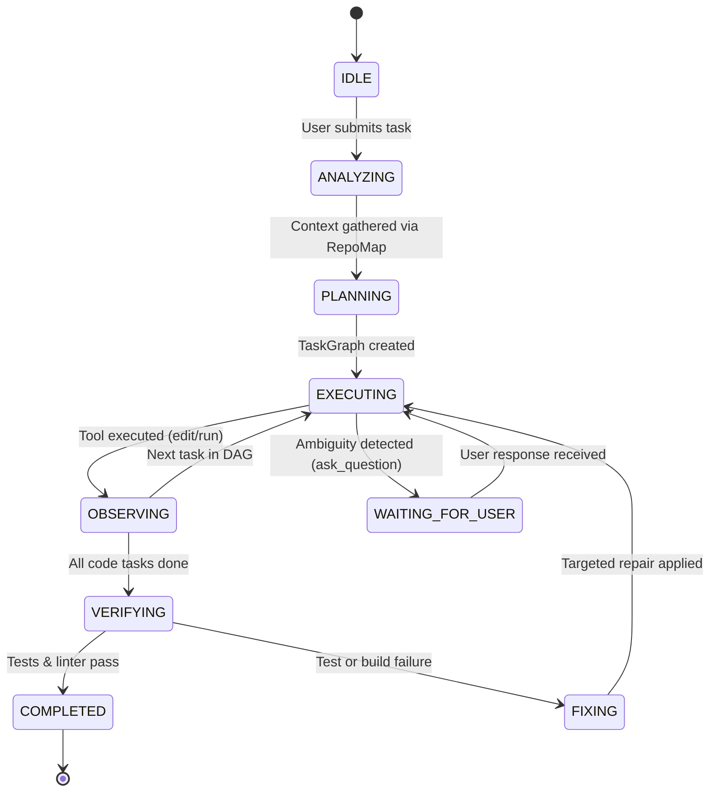

# CoreMind AI — Autonomous Software Engineering Agent

[](https://developer.nvidia.com/)
[](https://studio.nebius.ai/)
[](https://huggingface.co/nvidia)
[-brightgreen?style=for-the-badge&logo=pytest)](file:///Users/manojsarya/Documents/My%20Projects/CoreMind-AI-Backend/tests)
[](file:///Users/manojsarya/Documents/My%20Projects/CoreMind-AI-Backend/LICENSE)
[](https://www.python.org/)

> **Autonomous software engineering backend powered by NVIDIA Nemotron open-source models via Nebius Token Factory.**
> 
> CoreMind turns high-level software tasks into verified code through an autonomous execution cycle:
> **Plan → Inspect Context → Edit Files → Execute Sandbox → Run Tests → Observe Failures → Self-Heal & Patch → Re-verify → Review & Merge.**

---

## Table of Contents

1. [Hackathon Submission & Track Overview](#hackathon-submission--track-overview)
2. [Why NVIDIA Nemotron on Nebius Token Factory?](#why-nvidia-nemotron-on-nebius-token-factory)
3. [System Architecture](#system-architecture)
4. [Autonomous Agent Capabilities](#autonomous-agent-capabilities)
5. [End-to-End Hackathon Demo Walkthrough](#end-to-end-hackathon-demo-walkthrough)
6. [Complete Developer Setup Guide](#complete-developer-setup-guide)
   - [Prerequisites](#1-prerequisites)
   - [Step 1: Clone Repository](#2-clone-the-repository)
   - [Step 2: Virtual Environment](#3-create--activate-virtual-environment)
   - [Step 3: Install Dependencies](#4-install-dependencies)
   - [Step 4: Environment Variables Configuration](#5-configure-environment-variables)
   - [Step 5: Run Automated Tests](#6-verify-installation-with-tests)
   - [Step 6: Start Server (Local & Live Reload)](#7-start-the-backend-server)
   - [Step 7: Docker Container Setup](#8-running-with-docker)
7. [API Reference & Streaming Endpoints](#api-reference--streaming-endpoints)
8. [Test Suite & Verification (122 Passed)](#test-suite--verification)
9. [Security, Guardrails & Sandboxing](#security-guardrails--sandboxing)
10. [Repository Structure](#repository-structure)
11. [License & Acknowledgments](#license--acknowledgments)

---

## Hackathon Submission & Track Overview

| Track Item | Details |
|---|---|
| **Hackathon Track** | **Coding and Agentic Engineering Track** |
| **Project Name** | **CoreMind AI** (Backend Engine) |
| **Primary Model** | `nvidia/Nemotron-3_5-Lightning` / `nvidia/llama-3.3-nemotron-super-49b-v1` |
| **Inference Platform** | **Nebius Token Factory** (`https://api.studio.nebius.com/v1`) |
| **Repository License** | **MIT Open-Source License** |
| **Automated Tests** | **122 / 122 Tests Passing** (`pytest -v`) |
| **Core Objective** | Fully autonomous software engineering: plan, execute multi-file edits, run sandbox tests, diagnose stack traces, self-heal via atomic diffs, and re-verify until green. |

### The Problem
Traditional AI coding assistants act as static chatbots or autocomplete tools. They generate unverified snippets, hallucinate non-existent imports, lack whole-repo context, and break existing test suites. When code fails, the burden falls completely on the human engineer to diagnose errors, context-switch, copy-paste stack traces, and manually test fixes.

### The CoreMind Solution
CoreMind acts as an autonomous pair engineer embedded in the IDE:
1. **Whole-Repository Code Intelligence**: Parses ASTs, builds compact architectural repo maps, and searches across symbols, exact strings, and semantic queries.
2. **Deterministic Agent State Machine**: Navigates from `ANALYZING` to `PLANNING`, `EXECUTING`, `VERIFYING`, and `FIXING`.
3. **Safe Multi-Strategy File Engine**: Applies surgical atomic edits with AST syntax pre-validation so broken code never touches disk.
4. **Autonomous Self-Healing Loop**: Automatically executes tests, parses stdout/stderr traces, pinpoints root causes, creates targeted patches, and re-runs tests until verification succeeds.
5. **Non-Destructive Review Model**: Changes are isolated into unified diff `ChangeSets` that users can inspect, accept, or reject on a per-file or per-hunk basis, backed by Git snapshot checkpoints.

---

## Why NVIDIA Nemotron on Nebius Token Factory?

CoreMind leverages the **NVIDIA Nemotron** family of open-source models hosted on the high-performance **Nebius Token Factory** infrastructure:

### 1. Superior Agentic Reasoning & Tool Synthesis
Nemotron models excel at complex multi-step reasoning, structured JSON schema generation, and tool invocation. In an autonomous engineering loop, the agent must plan complex dependency graphs, choose between 18+ tools, and accurately generate syntax-valid code diffs without drifting from instructions.

### 2. High-Throughput, Low-Latency Inference
Agentic loops require multiple sequential model interactions per task:
```text
Analyze Task (1 turn) → Build TaskGraph (1 turn) → Read Files (2-3 turns) 
→ Apply Edits (1-2 turns) → Inspect Test Failures (1 turn) → Self-Heal Fix (1 turn) → Verify (1 turn)
```
Nebius Token Factory provides high token throughput and low time-to-first-token (TTFT) on NVIDIA GPU infrastructure, making multi-turn self-healing feasible in real-time developer workflows.

### 3. Deep Context Window (128K+)
Software engineering demands expansive context:
- System prompts containing coding standards and `.coremindrules`.
- Compact Repo Maps containing classes, interfaces, and signatures across dozens of files.
- Full unified diffs, terminal execution buffers, and compiler stack traces.
Nemotron's 128k+ context window handles multi-file engineering contexts with zero context degradation.

### Supported Nemotron Models on Nebius
Configurable on the fly via `NEBIUS_MODEL` in [`.env`](file:///Users/manojsarya/Documents/My%20Projects/CoreMind-AI-Backend/.env):

| Model Identifier | Context Window | Recommended Use Case |
|---|---|---|
| `nvidia/Nemotron-3_5-Lightning` *(Default)* | 131,072 tokens | Ultra-fast agentic reasoning, instant tool execution, and rapid self-healing |
| `nvidia/llama-3.3-nemotron-super-49b-v1` | 131,072 tokens | General software engineering, complex algorithmic implementations |
| `nvidia/Nemotron-3-Ultra-550b-a55b` | 131,072 tokens | Maximum reasoning capability, large-scale multi-file architectural refactoring |
| `nvidia/nemotron-3-super-120b-a12b` | 131,072 tokens | Deep architectural reasoning and complex bug diagnosis |
| `nvidia/NVIDIA-Nemotron-3-Nano-30B-A3B` | 131,072 tokens | Lightweight, ultra-responsive code generation and quick edits |

---

## System Architecture

```text
┌─────────────────────────────────────────────────────────────────────────┐
│                        CoreMind IDE Frontend                            │
│                 Electron + React + Monaco Editor                        │
└────────────────────────────────────┬────────────────────────────────────┘
                                     │ WebSocket Events & REST APIs
                                     ▼
┌─────────────────────────────────────────────────────────────────────────┐
│                        CoreMind AI Backend                              │
│                                                                         │
│  ┌───────────────────────────────────────────────────────────────────┐  │
│  │                     Agent Execution Engine                        │  │
│  │   • Deterministic State Machine (IDLE ➔ ANALYZE ➔ PLAN ➔ EXEC)    │  │
│  │   • Dynamic Task Graph (Dependency-aware DAG)                     │  │
│  │   • Autonomous Self-Healing Loop (Max 3 repair attempts)          │  │
│  └───────────────────────────────────────────────────────────────────┘  │
│                                                                         │
│  ┌─────────────────────────┐ ┌─────────────────────────┐ ┌────────────┐ │
│  │    Code Intelligence    │ │    Safe File Engine     │ │ Diff Engine│ │
│  │ • Tree-sitter / AST     │ │ • 4-Strategy Atomic Edit│ │ • Unified  │ │
│  │ • Compact RepoMap       │ │ • Syntax Pre-Validation │ │   Diffs    │ │
│  │ • Hybrid Search Engine  │ │ • Windowed Safe Reads   │ │ • ReviewSet│ │
│  └─────────────────────────┘ └─────────────────────────┘ └────────────┘ │
│                                                                         │
│  ┌─────────────────────────┐ ┌─────────────────────────┐ ┌────────────┐ │
│  │    Persistent Terminal  │ │     Git Checkpoints     │ │ Guardrails │ │
│  │ • Stateful sessions     │ │ • Pre-edit Git Snapshot │ │ • Path     │ │
│  │ • Background processes  │ │ • Isolated Rollback     │ │ • Command  │ │
│  │ • Sandbox execution     │ │ • User vs AI diff split │ │ • Redaction│ │
│  └─────────────────────────┘ └─────────────────────────┘ └────────────┘ │
└───────────────────┬─────────────────────────────────┬───────────────────┘
                    │                                 │
                    ▼                                 ▼
      ┌───────────────────────────┐     ┌──────────────────────────┐
      │   Nebius Token Factory    │     │    Local Execution Env   │
      │   NVIDIA Nemotron LLM     │     │  Sandbox, Pytest, Git,   │
      │   High-Speed Inference    │     │  Compilers & Linters     │
      └───────────────────────────┘     └──────────────────────────┘
```

---

## Autonomous Agent Capabilities



### 1. Autonomous Self-Healing Loop
When code changes fail unit tests or compilation:
- **Trace Capture**: Grabs standard error, exit codes, and failing test names.
- **Root-Cause Analysis**: Nemotron inspects the error trace alongside AST symbols and recent file diffs.
- **Atomic Patch Generation**: Generates targeted fixes and applies them through the multi-strategy editor.
- **Re-Verification**: Reruns the test suite. If successful, transitions to `COMPLETED`; if not, re-diagnoses (up to `MAX_REPAIR_ATTEMPTS = 3`).

### 2. Dynamic Directed Task Graph
Rather than unstructured text planning, CoreMind builds an actionable Directed Acyclic Graph (DAG) of discrete tasks. Tasks have strict lifecycle states (`PENDING`, `IN_PROGRESS`, `COMPLETED`, `BLOCKED`, `FAILED`, `SKIPPED`) and stream directly to the IDE UI in real-time.

### 3. Safe Multi-Strategy File Engine
File corruption is prevented using four tiered edit strategies:
1. **Strategy 1 (Exact Match)**: Surgical unique string replacement.
2. **Strategy 2 (Multi-Chunk Atomic)**: Multiple non-contiguous edits applied simultaneously.
3. **Strategy 3 (Line Range)**: Explicit line-bounded replacement.
4. **Strategy 4 (Fuzzy Whitespace Fallback)**: Tolerates whitespace and indentation shifts.
* **Pre-Write Syntax Validation**: Code is validated with language AST parsers before touching the disk. Malformed code is rejected before write.

### 4. Git Checkpoints & Rollback
Before executing any multi-file modification, CoreMind takes a lightweight Git checkpoint snapshot. If the user rejects the changes or verification completely fails, the system rolls back cleanly without affecting untracked user files.

### 5. Persistent Terminal Sessions
CoreMind maintains persistent shell sessions across turns. Environment activations (`source .venv/bin/activate`), working directory transitions (`cd`), and long-running background servers (`uvicorn`, `npm run dev`) remain alive across steps.

### 6. Interactive Human-in-the-Loop (`ask_question`)
If an ambiguous requirement arises (e.g., choosing between multiple database backends or auth providers), the agent invokes `ask_question`. The state machine pauses in `WAITING_FOR_USER` until the developer answers in the IDE.

---

## End-to-End Hackathon Demo Walkthrough

Here is the exact lifecycle demonstrated during our hackathon evaluation:

```text
┌────────────────────────────────────────────────────────────────────────┐
│ TASK: "Add an LRU Cache with TTL expiration and comprehensive tests"    │
└────────────────────────────────────────────────────────────────────────┘
                                    │
                                    ▼
1. ANALYZE & INSPECT
   • Agent reads project rules (.coremindrules).
   • Agent scans AST RepoMap to discover existing utils & test structure.
                                    │
                                    ▼
2. PLAN
   • Generates dynamic TaskGraph:
     - Task 1: Create src/utils/lru_cache.py with TTL support.
     - Task 2: Create tests/test_lru_cache.py with edge-case tests.
     - Task 3: Execute test suite and verify coverage.
                                    │
                                    ▼
3. EXECUTE & OBSERVE
   • Creates src/utils/lru_cache.py using write_file.
   • Creates tests/test_lru_cache.py using write_file.
   • Syntax validator checks AST -> Valid -> Written to disk.
                                    │
                                    ▼
4. VERIFY (Test Failure Detected!)
   • Agent triggers run_tests tool:
     Exit code 1: "AssertionError: Expected item to expire after 100ms"
                                    │
                                    ▼
5. SELF-HEALING & FIX
   • State machine shifts from VERIFYING ➔ FIXING.
   • Nemotron analyzes trace: Discovers monotonic clock precision mismatch.
   • Generates targeted unified diff for src/utils/lru_cache.py.
   • Multi-strategy editor applies exact atomic patch.
                                    │
                                    ▼
6. RE-VERIFY & COMPLETE
   • run_tests executed again: "All 6 tests PASSED in 0.12s".
   • Git checkpoint verifies clean diff.
   • State machine completes: Notification streamed to IDE frontend.
```

---

## Complete Developer Setup Guide

Follow these step-by-step instructions to set up, configure, and run CoreMind Backend locally.

### 1. Prerequisites

Ensure your development machine has:
- **Python 3.11+** installed:
  ```bash
  python3 --version
  ```
- **Git** installed:
  ```bash
  git --version
  ```
- **Nebius Token Factory API Key**: Sign up at [Nebius AI Studio](https://studio.nebius.ai/) to obtain your API key.

---

### 2. Clone the Repository

```bash
git clone https://github.com/NVIDIA-CoreMind/CoreMind-AI-Backend.git
cd CoreMind-AI-Backend
```

---

### 3. Create & Activate Virtual Environment

Isolate dependencies using Python's standard `venv`:

**macOS / Linux:**
```bash
python3 -m venv .venv
source .venv/bin/activate
```

**Windows (PowerShell):**
```powershell
python -m venv .venv
.venv\Scripts\Activate.ps1
```

**Windows (Command Prompt):**
```cmd
python -m venv .venv
.venv\Scripts\activate.bat
```

*(Your terminal prompt will now show `(.venv)`)*.

---

### 4. Install Dependencies

Upgrade pip and install core and development packages in editable mode:

```bash
pip install --upgrade pip
pip install -r requirements.txt
pip install -e ".[dev]"
```

---

### 5. Configure Environment Variables

Copy the provided example environment configuration:

**macOS / Linux:**
```bash
cp .env.example .env
```

**Windows:**
```cmd
copy .env.example .env
```

Open `.env` in your editor and configure your credentials:

```env
# ─── Nebius Token Factory / NVIDIA Nemotron ────────────────────────
NEBIUS_API_KEY=your_actual_nebius_api_key_here
NEBIUS_BASE_URL=https://api.studio.nebius.com/v1
NEBIUS_MODEL=nvidia/Nemotron-3_5-Lightning

# ─── Backend Server ────────────────────────────────────────────────
COREMIND_BACKEND_HOST=127.0.0.1
COREMIND_BACKEND_PORT=43110

# ─── Agent Settings & Limits ───────────────────────────────────────
MAX_AGENT_STEPS=20
DEFAULT_COMMAND_TIMEOUT_MS=120000

# ─── Agent Durable Memory ──────────────────────────────────────────
MEMORY_MAX_ITEMS=40
MEMORY_MAX_CONTENT_CHARS=400
MEMORY_PROMPT_ITEMS=8

# ─── Web Search (Optional) ─────────────────────────────────────────
TAVILY_API_KEY=your_tavily_api_key_here
WEB_SEARCH_MAX_RESULTS=5
WEB_SEARCH_TIMEOUT_S=12

# ─── Execution Sandbox ─────────────────────────────────────────────
SANDBOX_TYPE=local
SANDBOX_WORKING_DIR=

# ─── Authentication & JWT (Production / Local Dev) ─────────────────
JWT_SECRET_KEY=coremind-super-secret-jwt-key-2026-production-ready
JWT_ACCESS_TOKEN_EXPIRE_MINUTES=10080
JWT_REFRESH_TOKEN_EXPIRE_DAYS=30

# ─── Google OAuth (Optional for local testing) ─────────────────────
GOOGLE_CLIENT_ID=
GOOGLE_CLIENT_SECRET=
GOOGLE_REDIRECT_URI=http://127.0.0.1:43110/v1/auth/google/callback
FRONTEND_ORIGIN=http://localhost:5173,http://127.0.0.1:5173

# ─── Storage & Logging ─────────────────────────────────────────────
SQLITE_DB_PATH=data/coremind.db
LOG_LEVEL=info
```

> 🔒 **Security Notice**: Never commit `.env` with actual keys. It is ignored by Git in `.gitignore`.

---

### 6. Verify Installation with Tests

Run the full automated test suite to ensure the environment, tools, and state machine are healthy:

```bash
pytest -v
```

**Result:** All **122 tests pass** in ~2.5 seconds:
```text
============================= 122 passed in 2.36s ==============================
```

---

### 7. Start the Backend Server

#### Option A: Direct Launch
```bash
python3 main.py
```

#### Option B: Live Auto-Reload (Recommended for Development)
```bash
uvicorn src.app.bootstrap:app --host 127.0.0.1 --port 43110 --reload
```

#### Verify Server Endpoints
Open your browser to test endpoints:
- **Health Check**: [http://127.0.0.1:43110/health](http://127.0.0.1:43110/health) → `{"status":"ok"}`
- **Interactive Swagger Docs**: [http://127.0.0.1:43110/docs](http://127.0.0.1:43110/docs)
- **ReDoc Documentation**: [http://127.0.0.1:43110/redoc](http://127.0.0.1:43110/redoc)
- **Real-Time WebSocket Stream**: `ws://127.0.0.1:43110/ws`

---

### 8. Running with Docker

You can containerize and run the backend inside Docker:

```bash
# Build the Docker image
docker build -t coremind-backend:latest .

# Run the container with environment variables
docker run -d \
  -p 43110:8080 \
  --env-file .env \
  --name coremind-agent-backend \
  coremind-backend:latest
```

Verify the container is healthy:
```bash
curl http://localhost:43110/health
```

---

## API Reference & Streaming Endpoints

> 📘 **Detailed Guide**: For end-to-end frontend integration, TypeScript types, and WebSocket subscription examples, refer to [FRONTEND_API_GUIDE.md](file:///Users/manojsarya/Documents/My%20Projects/CoreMind-AI-Backend/FRONTEND_API_GUIDE.md).

### 1. Agent Orchestration APIs
| Method | Endpoint | Description |
|---|---|---|
| `POST` | `/v1/agent/run` | Start autonomous task execution loop with task prompt and context |
| `GET` | `/v1/agent/{agent_id}` | Fetch current agent state, active task, and execution history |
| `POST` | `/v1/agent/cancel` | Gracefully cancel a running agent execution |
| `POST` | `/v1/agent/question` | Submit answer to pending human-in-the-loop question |
| `GET` | `/v1/agent/questions` | List pending questions requiring human decision |
| `POST` | `/v1/agent/approve` | Approve high-risk tool execution |
| `POST` | `/v1/agent/deny` | Deny high-risk tool execution |

### 2. Project Intelligence APIs
| Method | Endpoint | Description |
|---|---|---|
| `POST` | `/v1/project/open` | Open workspace root, auto-detect framework & active rules |
| `GET` | `/v1/project/tree` | Fetch hierarchical file tree structure |
| `GET` | `/v1/project/search` | Execute hybrid search (exact + regex + symbols + semantic) |
| `GET` | `/v1/project/repo_map` | Retrieve compact AST repository symbol summary |

### 3. Change Review & Diff APIs
| Method | Endpoint | Description |
|---|---|---|
| `GET` | `/v1/changes/{change_id}` | Preview generated unified diffs and file statistics |
| `POST` | `/v1/changes/{change_id}/accept` | Accept and merge all staged changes |
| `POST` | `/v1/changes/{change_id}/reject` | Revert all modifications via Git rollback checkpoint |
| `POST` | `/v1/changes/{change_id}/accept_file` | Accept changes for a specific file |
| `POST` | `/v1/changes/{change_id}/reject_file` | Revert modifications for a specific file |

### 4. Persistent Terminal & Background Process APIs
| Method | Endpoint | Description |
|---|---|---|
| `POST` | `/v1/terminal/session` | Create persistent terminal session (preserves CWD & env) |
| `POST` | `/v1/terminal/session/{id}/execute` | Run shell command in session |
| `DELETE`| `/v1/terminal/session/{id}` | Terminate terminal session |
| `POST` | `/v1/terminal/process/start` | Launch long-running process (e.g. dev server) |
| `GET` | `/v1/terminal/process/{id}/status`| Inspect background process lifecycle |
| `GET` | `/v1/terminal/process/{id}/logs` | Tail process stdout/stderr stream |
| `POST` | `/v1/terminal/process/{id}/stop` | Terminate background process |

### 5. WebSocket Event Stream (`/ws`)
Real-time streaming enables instantaneous UI updates in the CoreMind IDE:
- `agent.started` — Initialized agent session.
- `plan.created` — TaskGraph DAG generated with nodes and dependencies.
- `task.started` / `task.completed` — Real-time progress on discrete subtasks.
- `tool.invoked` — Tool call dispatched (e.g., `edit_file`, `run_tests`).
- `diff.created` — Staged unified diff generated for review.
- `verification.started` / `verification.passed` / `verification.failed` — Sandbox verification status.
- `agent.waiting_for_user` — Agent paused awaiting human response.
- `agent.completed` — Autonomous workflow successfully verified and finished.

---

## Test Suite & Verification

The backend maintains **100% passing automated test coverage** across 12 distinct test suites with **122 automated unit and integration tests**:

```bash
pytest -v
```

### Breakdown of Test Suites
- [`tests/test_state_machine.py`](file:///Users/manojsarya/Documents/My%20Projects/CoreMind-AI-Backend/tests/test_state_machine.py): Verifies state transitions, error recovery loops, terminal states, and approval flows.
- [`tests/test_phase1.py`](file:///Users/manojsarya/Documents/My%20Projects/CoreMind-AI-Backend/tests/test_phase1.py): Validates TaskGraph DAG, multi-strategy file editing, AST syntax validation, and unified diff/patch algorithms.
- [`tests/test_phase2.py`](file:///Users/manojsarya/Documents/My%20Projects/CoreMind-AI-Backend/tests/test_phase2.py): Tests symbol extraction (Python, Dart, TS), compact RepoMap creation, hybrid search, and rule ingestion.
- [`tests/test_phase3.py`](file:///Users/manojsarya/Documents/My%20Projects/CoreMind-AI-Backend/tests/test_phase3.py): Tests ChangeSet review lifecycle, Git checkpoints & rollback, question manager, and persistent terminal sessions.
- [`tests/test_security.py`](file:///Users/manojsarya/Documents/My%20Projects/CoreMind-AI-Backend/tests/test_security.py): Confirms path traversal blocks, prohibited command detection (`rm -rf`, `sudo`), and secret redaction.
- [`tests/test_memory.py`](file:///Users/manojsarya/Documents/My%20Projects/CoreMind-AI-Backend/tests/test_memory.py): Validates bounded agent memory persistence, LRU eviction, and prompt compaction.
- [`tests/test_context.py`](file:///Users/manojsarya/Documents/My%20Projects/CoreMind-AI-Backend/tests/test_context.py): Validates token compaction, tool result truncation, and message history optimization.
- [`tests/test_detector.py`](file:///Users/manojsarya/Documents/My%20Projects/CoreMind-AI-Backend/tests/test_detector.py): Validates project type detection (Python, Flutter, Node, Rust, Go, Next.js).
- [`tests/test_auth.py`](file:///Users/manojsarya/Documents/My%20Projects/CoreMind-AI-Backend/tests/test_auth.py): Tests JWT creation/refresh and Google OAuth flow.
- [`tests/test_registry.py`](file:///Users/manojsarya/Documents/My%20Projects/CoreMind-AI-Backend/tests/test_registry.py): Confirms tool registration, OpenAI function format transformation, and permission filtering.
- [`tests/test_web_search.py`](file:///Users/manojsarya/Documents/My%20Projects/CoreMind-AI-Backend/tests/test_web_search.py): Validates live external search integration with Tavily and DuckDuckGo fallback.
- [`tests/test_integration.py`](file:///Users/manojsarya/Documents/My%20Projects/CoreMind-AI-Backend/tests/test_integration.py): End-to-end integration test validating the complete lifecycle.

---

## Security, Guardrails & Sandboxing

CoreMind operates safely on host environments through a defense-in-depth security model:

1. **Path Policy Guardrails**:
   - Strictly confines all file operations to the opened project root.
   - Blocks path traversal attacks (`../../`).
   - Blocks read/write access to sensitive files (`.env`, `.git/credentials`, `.ssh/id_rsa`, `*.pem`, `*.key`).
2. **Command Execution Guardrails**:
   - Analyzes all terminal invocations before execution.
   - Blocks destructive shell operations (`rm -rf /`, `mkfs`, `dd`, `sudo`, `curl | bash`).
   - Requires explicit developer approval for high-risk system commands.
3. **Secret Redaction Filter**:
   - Automatic regex redaction strips API keys, OAuth tokens, and JWT credentials from terminal outputs, log files, and LLM message payloads.
4. **Sandboxed Subprocess Execution**:
   - Executes commands inside isolated subshells with configurable timeouts (`DEFAULT_COMMAND_TIMEOUT_MS`) to prevent hanging processes or resource starvation.

---

## Repository Structure

```text
CoreMind-AI-Backend/
├── 00-project-overview.md     # Hackathon MVP goals & specifications
├── FRONTEND_API_GUIDE.md      # Integration guide & TypeScript SDK examples
├── CONTRIBUTING.md            # Contribution guidelines & code standards
├── Dockerfile                 # Production Docker container configuration
├── pyproject.toml             # Python build configuration & dependencies
├── requirements.txt           # Pinned production requirements
├── main.py                    # Server startup entrypoint
├── tests/                     # 12 test suites (122 passing tests)
│   ├── test_state_machine.py  # Agent state transitions
│   ├── test_phase1.py         # TaskGraph, Diff/Patch, File Editing
│   ├── test_phase2.py         # Symbols, RepoMap, Hybrid Search
│   ├── test_phase3.py         # Checkpoints, Review, Terminal Sessions
│   ├── test_security.py       # Guardrails, Path Policy, Redaction
│   ├── test_integration.py    # End-to-end workflow verification
│   └── ...                    # Context, Memory, Auth, Registry tests
└── src/                       # Core engine source code
    ├── agent/                 # Agent loop, state machine, task graph, verifier
    ├── ai/                    # Nebius client & NVIDIA Nemotron model integration
    ├── api/                   # FastAPI routes (agent, project, terminal, changes)
    ├── app/                   # Application bootstrap & lifecycle hooks
    ├── auth/                  # JWT auth, user sessions, Google OAuth
    ├── changes/               # Unified diff engine & ChangeSet review model
    ├── context/               # Context window management & compaction
    ├── events/                # WebSocket event streaming manager
    ├── memory/                # Durable agent memory store
    ├── project/               # Project detector, repo map, AST symbol parser
    ├── sandbox/               # Isolated command execution sandbox
    ├── security/              # Path policy, command policy, secret redaction
    ├── terminal/              # Persistent terminal sessions & background procs
    └── tools/                 # 18+ agent tool implementations
```

---

## License & Acknowledgments

- **License**: Released under the open-source [MIT License](file:///Users/manojsarya/Documents/My%20Projects/CoreMind-AI-Backend/LICENSE).
- **Hackathon Track**: **Coding and Agentic Engineering Track**.
- **Model Provider**: Powered by open-source **NVIDIA Nemotron** models.
- **Inference Cloud**: Hosted and accelerated on **Nebius Token Factory** / **Nebius AI Cloud**.
